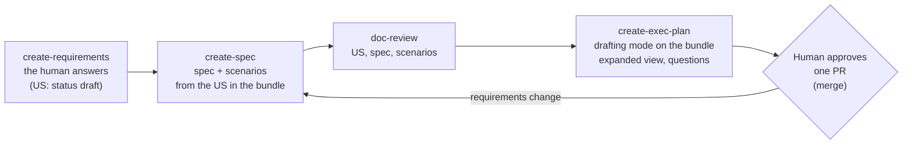

# Bundled approval — approving the definitions of one feature in one PR

> **Single source.** `create-requirements` (the handoff), `create-spec` (drafting from a US in the
> bundle), `doc-review` (the findings on a bundle), `create-exec-plan` (drafting mode on a bundle),
> [`e2e-interaction.md`](e2e-interaction.md) (what the comparison reads, and when the freeze happens)
> and CLAUDE.md all apply **this** file. Do not restate the flow, the reading rule or the freeze rule
> inline in a skill — reference this file.

## Why this exists

A feature used to reach its plan through as many as three approvals: the US merged to `main`, then
the spec and its scenarios merged, then the plan. Each merge is a human approval, but after the US
only the first is about something a human decided — the spec, the scenarios and the plan are drafted
by the agent from the US. Approving them one at a time spends three review rounds, and each approval
is of a fragment: the spec without the plan that will build it, the plan without the spec changes
that would follow from a question it raises.

So the **standard** is to approve them together: the human answers the requirements dialogue as
before, the agent drafts everything that follows on the same branch and has it reviewed
independently, and the human approves the whole definition — requirements, spec, scenarios and plan
— in **one PR**, reading the expanded view. Approving stage by stage remains available.

---

## What does not change

- **The requirements dialogue.** The US AC conditions and the goal image
  (`create-requirements` Q3 and Q4) are answered by the human. Drafting them would turn the human's
  part into accepting a draft, which is what this template exists to avoid.
- **Every check and its criteria.** Readiness, sources, the scenario comparison, the walkthrough
  judgement — they run as they always do. What changes is which copy of the documents they read
  before the merge (below), and that the human sees them all at once.
- **Approval is a merge.** The human approves by merging the PR. Nothing in this file lets the agent
  approve.

---

## The flow



The diagram is the bundled path: one branch from `main`, carrying only documents and the plan.

| Step | Who | What |
|------|-----|------|
| 1 | Human (dialogue) | `create-requirements` — the US with its AC conditions and goal image, `status: draft`, on a branch of its own (`define/<feature>` or the project's pattern) |
| 2 | Agent | `create-spec` on the same branch — the spec and its scenarios, from the US **in the bundle** (its `status: draft` is not a halt here, below) |
| 3 | Agent | `doc-review` on the US, the spec and each scenario. Act on its findings by who decided the text (below) |
| 4 | Agent → human | `create-exec-plan` in drafting mode on the bundle: the expanded view and its questions. The plan file is written once every question is answered, as always (`../create-exec-plan/expanded-view.md`) |
| 5 | Agent | Open the PR — on the human's instruction, since it is outward. Its body carries the expanded view (a reviewer cannot read `.claude/views/`), and lists the documents the PR approves |
| 6 | Human | Read, answer what is open, approve: merge the PR. Just before the merge, the `status:` of every bundle document goes from `draft` to `active` — a commit the agent drafts on the human's instruction to approve ([`../run-exec-plan/decision-requests.md`](../run-exec-plan/decision-requests.md)), in the same PR |

**When the requirements change during review**, the human answers the dialogue again for what
changed, and the agent drafts again from step 2: the spec, the scenarios and the plan are derived,
so they follow the US. The expanded view is regenerated, and only the questions whose quoted text
changed are asked again (`../create-exec-plan/expanded-view.md`「The lifecycle」).

**Implementation is on another branch.** The definition PR adds documents and a plan and implements
nothing — `pre-pr` ⑦ reads it as a branch that has not started the plan (`➖`). Implementing on it
would make it a branch with one plan's implementation and another change's definitions, which the
completion checks cannot tell apart (`../complete-exec-plan/completion-boundary.md`「When part of a
plan has to merge before the rest」). After the merge, `run-exec-plan` (or `start-feature`) starts the
implementation from `main` — and both refuse to start on the definition branch before it.

### Acting on the review findings

`doc-review` changes no files. Who acts on a finding depends on who decided the text it is about:

| The finding is about… | Who decided it | Action |
|-----------------------|----------------|--------|
| The spec, a scenario, the plan — anything the agent drafted | The agent | The agent fixes it, and re-runs `doc-review` on what it changed |
| The US story, its AC conditions, its goal image or non-goals | The human (the dialogue) | A **question** to the human, as a decision request; the agent drafts the edit once they decide (`../run-exec-plan/decision-requests.md`) |
| Unclear which | — | A question |

A finding in the agent's text that can only be fixed by changing the human's — the spec cannot
satisfy an AC condition as written, say — is about the human's text.

---

## What the checks read before the merge

The checks that read the current target — the scenario comparison
([`e2e-interaction.md`](e2e-interaction.md)), the drafting mode's "approved documents"
(`../create-exec-plan/SKILL.md`「Two modes」), the sources a plan's rows name — read `main`, because
`main` is what a plan is frozen against. In a bundle, the documents the plan is drawn from are not on
`main` yet: they are being approved **together with the plan**.

| Document | Read from |
|----------|-----------|
| A document **in the bundle** (added or changed by this definition branch) | The definition branch — the version the human is approving with the plan |
| Any other document | `main`, as always |

This is a rule about which copy to read, not a weaker check: the comparison still runs on every row,
with the same comparison set, and a finding is still a question the plan cannot be written past. A
document the branch changed that is **outside** the feature — an unrelated spec edit — is not part of
the bundle; keep it out of the definition PR, or approve it in its own PR first.

After the merge the bundle *is* `main`, and every later check — `start-feature`, `run-exec-plan`
Step 0b, the re-anchor — reads `main` again. Nothing is read from a branch once the definitions are
approved.

---

## When the approval and the freeze happen

For a document, **approval** is its merge to `main`; for a scenario, the **freeze** is per plan,
when a plan naming it is finalized ([`e2e-interaction.md`](e2e-interaction.md)「The freeze point」).
In a bundle both happen at **the merge of the definition PR**:

- The plan file is written on the branch when the human has answered the expanded view, but the
  branch can still change — a review comment, a changed requirement. Until the merge, a change to a
  bundle document re-runs the checks on the rows that name it, and the plan is redrafted from it;
  no plan has a claim on the scenario yet.
- At the merge, the documents become the current target and the plan freezes its scenarios.

The plan records this in its Decision Log when it is written:

```markdown
- 一括承認: `US-003`・`docs/02_spec/app_spec.md`・`E2E-001` とこのプランを1つの PR で承認する（定義ブランチ `define/tagging`）。承認と凍結は PR のマージ時点。
```

and the merge commit is the record of the freeze (`created:` predates it).

---

## Staged approval — still available

The human may approve stage by stage instead: merge the US, then run `create-spec` on `main` and
merge the spec and scenarios, then run `create-exec-plan`. Every skill works as before on that path:
`create-spec` halts on a US that is `status: draft` and not part of a bundle (unless the human
confirms drafting from it), and the checks read `main` throughout.

| Choose | When |
|--------|------|
| Bundled (standard) | One feature whose spec and plan follow from one US — the usual case |
| Staged | The requirements need agreement from others before anything is drafted from them, or the spec spans several US files that are approved at different times |

---

## Where this is applied

| Call site | When | Action |
|-----------|------|--------|
| `create-requirements` | Handoff | Suggests the bundled path: continue on the same branch with `create-spec` |
| `create-spec` (Step 1) | A source US is `status: draft` | Not a halt when the US is in the bundle (on this definition branch); a halt otherwise, as before |
| `doc-review` | Reviewing a bundle | Advisory as always; the caller acts on the findings by who decided the text |
| `create-exec-plan` (drafting mode) | Drawing from a US in the bundle | Reads the bundle's documents from the branch; records the `一括承認:` line |
| [`e2e-interaction.md`](e2e-interaction.md) | The comparison and the freeze | Reads bundle documents from the branch before the merge; the freeze is the merge |
| `pre-pr` (⑦) | The definition PR | `➖` — the branch adds documents and a plan, and implements nothing |
| `run-exec-plan` (Step 0) / `start-feature` (Step 1) | A plan whose `一括承認:` bundle is not on `main` yet | Do not start: the definition PR merges first, and the implementation begins from `main` |
