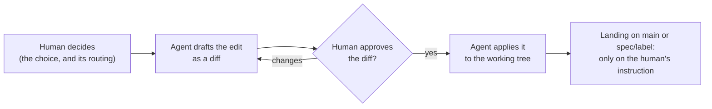

# Decision requests — the human decides, the agent writes it down

> **Single source.** `run-exec-plan` (presenting a HALT), `start-feature`, `pre-pr` (③),
> `create-spec`, `promote-spec`, `check-doc-invariants` (DOC-INV-006's migration hint) and the
> single sources that route a decision back to a human (`../create-spec/e2e-interaction.md`,
> `../create-exec-plan/ac-sources.md`) all apply **this** file. Do not restate the request format,
> the drafting protocol or the record suffix inline in a skill — reference this file.

## Why this exists

DocDD keeps every decision about *what to build* with a human. It used to keep the writing that
follows the decision with the human too: after choosing which of two documents is right, the human
edited the one that lost; after naming the file a broken `## Sources` row should point at, the human
repointed the row; after deciding to wait for a promotion, the human wrote the `deferred:` bullet.
None of that writing is a decision — the decision was made a moment earlier — and it is where a
decided change most often stalls or is written in a form the checks do not recognize.

The same holds on the asking side. A HALT that reads `HALT at AC-003 (stop condition a): R2 —
complement detection found a gap in E2E-001` can only be answered by someone who knows the
convention. The human is asked to decide about the product, and should be asked in product words.

So the line is drawn where CLAUDE.md draws it everywhere else: **the human decides, the agent
writes.** The agent never decides, and it never writes a decision into a document before the human
has approved the text.

---

## Asking — the form of a decision request

A decision request is what a skill puts to the human when it stops for a decision — a HALT of
`run-exec-plan`, a finding `start-feature` or `pre-pr` presents, a question in the expanded view of
`create-exec-plan`. It follows the same rules as the expanded view's 「決めてほしいこと」
(`../create-exec-plan/expanded-view.md`, V5 and V6):

| # | Rule | Why |
|---|------|-----|
| Q1 | **One decision per request**, stated in product words — what the product would do differently, not which check fired. The check's ID (`R2`, stop condition (a), DOC-INV-012) goes in a final machine-facing line | The human is deciding about the product; the ID is for the record |
| Q2 | **Every option the human has**, each with **what changes if it is chosen**: the documents edited, and the edit itself as a diff (below). Include "leave it" when it is an option, and what leaving it means (the run stays halted, the plan stays NOT READY) | An option whose consequence is not shown is answered by guessing |
| Q3 | **A recommendation, with its reason**, marked as the agent's | A recommendation helps the human answer quickly. Marking it keeps it from reading as the answer |
| Q4 | **Where the choice also needs a routing** (`main` or `spec/<label>`, CLAUDE.md「変更のルーティング」), ask it with the choice — and say what each routing means for this plan (proceeds once merged / waits for the promotion) | The routing is the human's too; an edit drafted without it cannot be placed |
| Q5 | **Quote the documents that disagree**, verbatim, with file and section | The human must compare the text, not the agent's reading of it |

**Where the request goes.** A short request is written in the conversation. When the diffs are long
— several documents, several options — write the request to
`.claude/views/<plan file name without .md>.decision.md` (the expanded view's place, under the same
rules: not committed, outside every range a check reads) and give its path; the conversation then
carries the question and the options in one line each.

**For `run-exec-plan`**, the Decision Log's HALT entry stays as the resume-state convention defines
it (that is what a new session reads); the decision request is what the run **says** when it stops.

---

## Writing — after the human has decided



The diagram is the protocol. The agent never enters it at A: a drafted edit always answers a decision
the human stated, in this conversation.

| Rule | Detail |
|------|--------|
| **Draft only what was decided** | The diff carries out the stated decision and nothing else. A second change the agent notices while drafting is a new decision request, not part of this diff |
| **Approval is of the diff shown** | The human approves the text they saw. A diff changed after approval is approved again. Silence, or "OK" said before the diff was shown, is not approval |
| **Apply where the check will read it** | An edit to the **plan file** (a `## Sources` row, a deferral bullet, an AC line) is applied to the current working tree — the plan lives on its branch. An edit to a **US, spec or scenario** is a spec change routed to `main` or `spec/<label>`, and is prepared there — on a branch from `main` (or `spec/<label>`), never in the plan's implementation branch: the scenario comparison and the source checks read `main`, so a fix sitting on the implementation branch would leave the plan halting on the same finding until its own merge, which waits for the plan |
| **Stop at the outward step** | Committing on `main` or `spec/<label>`, pushing and opening a PR are outward or routing steps, taken only on the human's instruction (CLAUDE.md: stop condition (d)) |
| **Not inside the unattended loop** | `run-exec-plan` still halts and edits neither document. Drafting happens in the conversation after the halt, where the human is present. A resumed run reads the documents, not this conversation: the plan proceeds once the edit is where the check reads it (`main` for the scenario comparison) |
| **A decision that is not in the conversation is not in hand** | A decision stated in an earlier session counts only if it is recorded in a file (the plan's Decision Log). Otherwise ask again |

### What the agent may draft

| Edit | The human decides | The agent drafts |
|------|-------------------|------------------|
| The losing side of a **contradiction** between frozen documents (`../create-spec/e2e-interaction.md`) | Which side is the target, and the routing — including, for a broader winning side, in-version or next-version | The edit to the document that lost; for a next-version broader side, the `main` edit on the narrower side and the `- E2E 次版戻し:` bullet |
| A **requirements gap** resolved by ① promote or ② drop (`e2e-interaction.md`) | ①, ② or ③, and the routing | ① the promotion into the section of the comparison set the human names, in the scenario's own wording; ② the removal from the scenario. ③ is a rework of the US, done through `create-requirements` — not drafted here |
| A **`## Sources` row** that cannot be opened, names background material, or names a file a move broke (`../create-exec-plan/ac-sources.md`) | The file and section the row should name — or `n/a` and its reason. The agent may list candidates as options; it does not pick one | The row edit, in the same change as the move when a move caused it |
| A **deferral** and its lifting (`e2e-interaction.md`「Deferring a plan, and lifting it」) | To defer, until which `spec/<label>`, and why — and later, to lift it | The `- deferred:` / `- deferred 解除:` bullet |
| An **old-layout scenario migration** (`check-doc-invariants` DOC-INV-006) | Which scenarios to move, and when | The new `docs/01-02_e2e/E2E-NNN_*.md` files, the removal of the blocks from the spec, and the repointing of every active plan's `## Sources` row that names them — one change |
| An **AC rewrite** after NOT READY | The rewritten criterion — chosen from drafted rewrites, or in the human's own words | The AC line and the Decision Log record |

---

## Record format

The decision is recorded in the format its own single source defines — the `補完検出:` lines of
`e2e-interaction.md`, `- deferred:`, `- E2E 次版戻し:`, the HALT entry, the Progress Log line of
`start-feature`. When the agent drafted the text, end the record with:

```markdown
（記述: AI 起草・人が承認 YYYY-MM-DD）
```

The suffix sits at the **end** of the line, so the markers that are read by their beginning
(`- deferred: spec/`, `- E2E 次版戻し:`) still match. It says the decision was the human's and the
words were the agent's — which is what a later reader needs to know when the two seem to disagree.

---

## Where this is applied

| Call site | When | What it applies |
|-----------|------|-----------------|
| `run-exec-plan` (stop conditions) | On every halt | Asking: the decision request, in product words with options, diffs and a recommendation. Writing: in the conversation after the halt, never in the loop |
| `start-feature` (Step 1b / Step 2) | A NOT READY criterion, a row that cannot be opened or names background material, a source conflict, a scenario finding | Asking and writing |
| `pre-pr` (③) | A DOC-INV-012 row of this PR, a DOC-INV-006 scenario finding | Asking. Writing once the human names the target — still never a guessed row |
| `create-spec` / `check-doc-invariants` (DOC-INV-006 migration hint) | An old-layout `## E2E シナリオ` section | Writing the migration once the human decides to move |
| `promote-spec` (Step 4 / Step 6) | `## Sources` rows the promotion breaks; plans deferred until the label | Asking; writing the repointing (Step 6, on `main` before the push) and the `deferred 解除:` bullets once the human decides |
| `create-exec-plan` (drafting mode) | Every question of the expanded view | Asking follows the expanded view itself (`../create-exec-plan/expanded-view.md`) |
